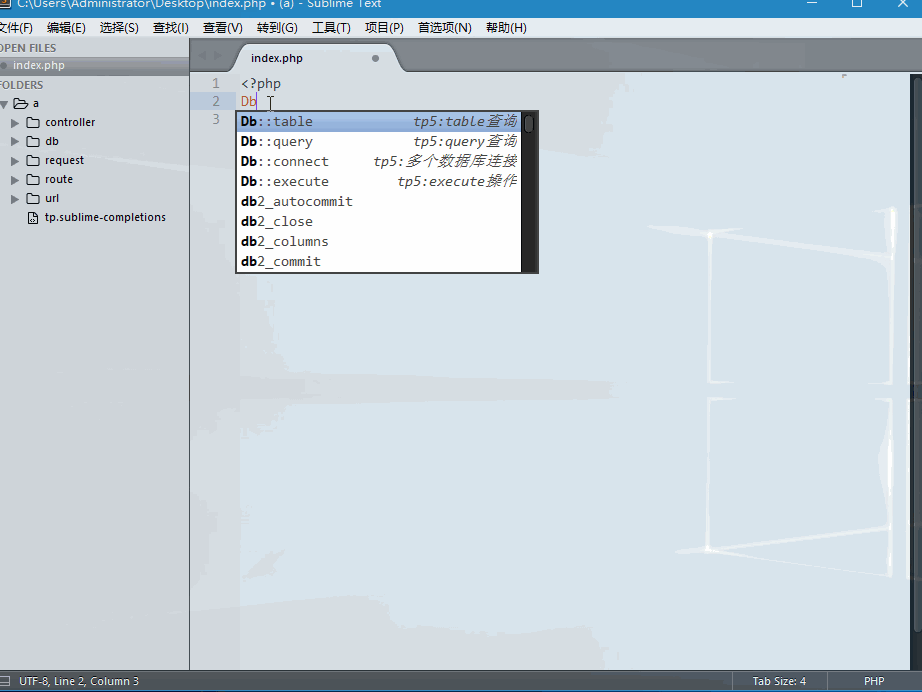
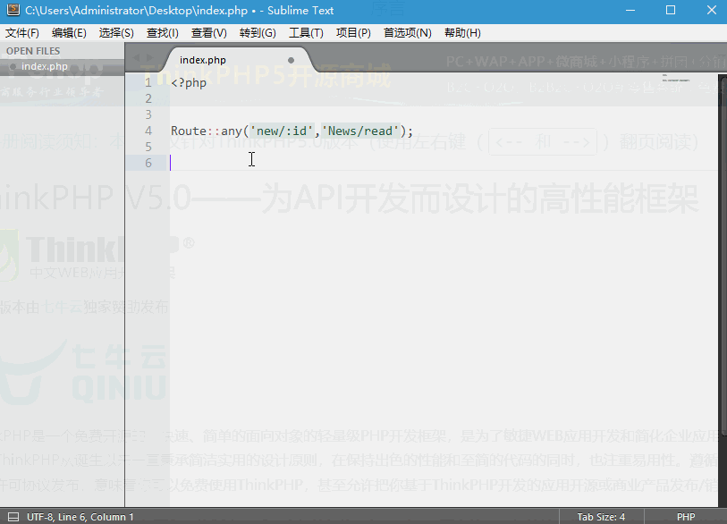

# sublime_thinkphp5

[](https://github.com/chenbool/sublime_thinkphp5/stargazers)
[](https://github.com/chenbool/sublime_thinkphp5/network)
[](https://github.com/chenbool/sublime_thinkphp5/blob/master/LICENSE)

> Sublime Text 语法提示插件，支持 ThinkPHP5 框架

## 功能特性

| 特性 | 说明 |
|------|------|
| 代码片段 | 166+ 个代码片段 |
| 完整覆盖 | 覆盖 ThinkPHP5 核心功能 |
| 智能提示 | 支持 Tab 键快速补全 |
| 调试函数 | 内置常用调试方法 |

## 安装

| 工具 | 安装文档 |
|------|----------|
| Sublime Text | [sublime 安装教程](https://github.com/chenbool/sublime_thinkphp5/wiki/Sublime%E5%AE%89%E8%A3%85) |
| VS Code | [vscode 安装教程](https://github.com/chenbool/sublime_thinkphp5/wiki/vscode%E5%AE%89%E8%A3%85) |

## 演示






## 代码片段总览

| 分类 | 数量 | 说明 |
|------|------|------|
| Controller | 9 | 控制器相关 |
| Model | 9 | 模型关联 |
| DB | 44 | 数据库操作 |
| Request | 36 | 请求对象 |
| Route | 15 | 路由配置 |
| Cache | 7 | 缓存操作 |
| Cookie | 5 | Cookie 操作 |
| Session | 5 | 会话操作 |
| Log | 10 | 日志操作 |
| Validate | 6 | 验证器 |
| View | 2 | 视图渲染 |
| URL | 3 | URL 构建 |
| Bug | 4 | 调试函数 |
| File | 3 | 文件操作 |

## 核心功能详解

> 更多触发词请查看对应目录下的 .sublime-snippet 文件

## 使用示例

```php
// 数据库查询
Db::name('user')->where('id', 1)->find();

// 模型关联
$user->hasMany('orders')->select();

// 请求参数
request()->param('name');

// 缓存操作
Cache::get('key');

// 路由定义
Route::get('hello/:name', 'index/hello');
```

## 相关项目

| 项目 | 仓库地址 |
|------|----------|
| ThinkPHP5 语法提示 | https://github.com/chenbool/sublime_thinkphp5 |
| Yaf 语法提示 | https://github.com/chenbool/sublime_yaf |
| Swoole 语法提示 | https://github.com/chenbool/sublime_swoole |

## 交流群

- QQ 群：484043598

## License

MIT License
